# MetalSprocketsParticles Demos

Every sample preset as a four-second loop, rendered offscreen with `particles-render --video` (seed 0, the
preset's camera). Regenerate them with `Scripts/make-demos.sh`.

## Contents

- [Fountain](#fountain)
- [Campfire](#campfire)
- [Fireworks](#fireworks)
- [Sparks](#sparks)
- [Snow](#snow)
- [Rain](#rain)
- [Magic Trail](#magic-trail)
- [Comet](#comet)
- [Galaxy](#galaxy)
- [Waterfall](#waterfall)
- [Confetti](#confetti)
- [Portal](#portal)
- [Hearts](#hearts)
- [Moon Phases](#moon-phases)
- [Color Smoke](#color-smoke)
- [Fog](#fog)
- [Pond](#pond)
- [Ring of Fire](#ring-of-fire)
- [Swarms](#swarms)
- [Geyser](#geyser)
- [Bumper](#bumper)
- [Paddle Wheel](#paddle-wheel)
- [Teapot](#teapot)
- [Flag](#flag)
- [Strange Attractor](#strange-attractor)
- [Pointer Stir](#pointer-stir)
- [Embers to Ash](#embers-to-ash)
- [Awning](#awning)
- [Lantern](#lantern)
- [Dunk](#dunk)
- [Flare](#flare)
- [Point Cloud](#point-cloud)
- [Fireflies](#fireflies)
- [Butterfly Dust](#butterfly-dust)
- [Paint Drops](#paint-drops)
- [Magic Loop](#magic-loop)
- [Torch Avenue](#torch-avenue)
- [Ember Glow](#ember-glow)
- [Coin Shower](#coin-shower)
- [Sand on Shapes](#sand-on-shapes)
- [Spark Spectrum](#spark-spectrum)
- [Light Ribbons](#light-ribbons)
- [Murmuration](#murmuration)

## Fountain

A water fountain sprays up and falls back onto the ground and a few colliders that move around. Shows gravity, bouncing, and colliders that push and carry particles as they move.

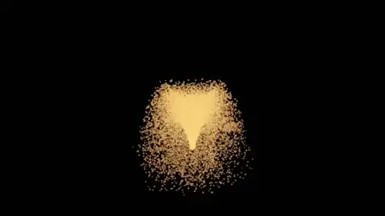

## Campfire

Flames, rising smoke, and embers over two logs. The flames are additive smoke puffs, the smoke is alpha-blended and sorted back to front, the embers are velocity-stretched sparks, and turbulence makes everything flicker. The logs are rotated capsule colliders.

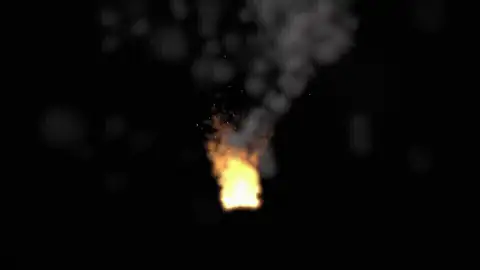

## Fireworks

Rockets climb from the ground, leave sparkle trails, and burst into shells of stars when they burn out. Shows sub-emitters: a while-alive trail and an on-death burst.

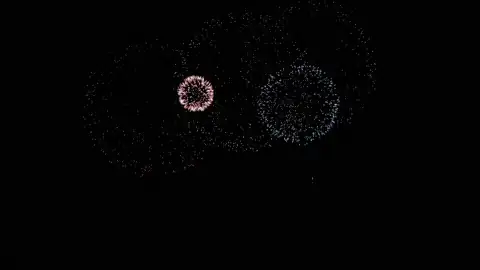

## Sparks

Grinder sparks streak across the floor and bounce off a wall. Shows velocity-aligned stretching, bounce with per-particle variation, and friction.

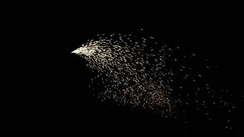

## Snow

Snowflakes drift down through gentle turbulence and settle on the ground and on a sphere. Shows plane emission over a large area, turbulence, and particles that come to rest on colliders.

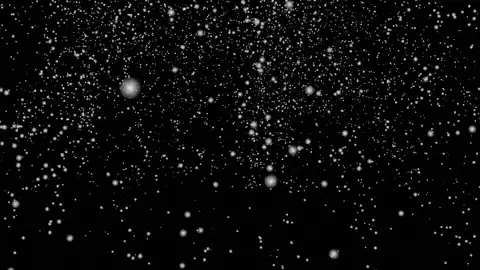

## Rain

Rain falls onto the ground and a tilted slab. Each drop dies when it hits and splashes where it lands. Shows velocity stretching, die-on-collision, and an on-collision sub-emitter.

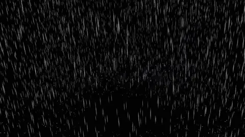

## Magic Trail

A wand of stars traces a figure eight, leaving a continuous trail and drifting dust. Shows a moving emitter, births spread along its path, and inherited velocity.

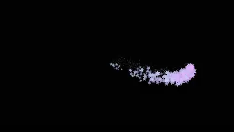

## Comet

A comet circles overhead with a long glowing tail and a bright core. Shows a fast-moving emitter that still leaves a smooth trail.

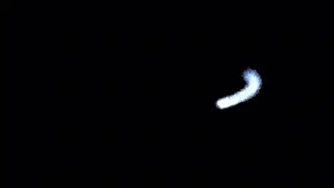

## Galaxy

Two spiral arms of stars swirl around a bright core. Shows torus emitters, a vortex force field, and an attractor.

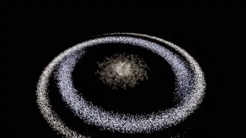

## Waterfall

A sheet of water pours over a ledge, hits rocks, and throws up mist. Shows a box emitter, collisions, and soft sorted mist.

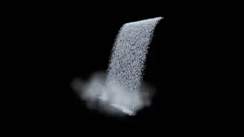

## Confetti

A party popper fires one burst of confetti, which flutters down, settles on the ground, and fades. Shows a one-shot emitter (an emission duration that does not loop), which makes the effect finite: when every piece is gone the HUD says Finished, and Restart in the toolbar plays it again. Also shows textured sprites with random spin, turbulence, and friction.

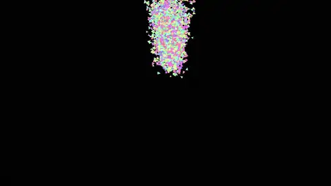

## Portal

A sorcerer's portal: a spinning ring of fire that throws sparks off its rim like a Catherine wheel. Shows tangential birth direction and a spinning emitter whose births spread along its rotation.

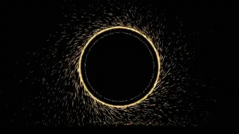

## Hearts

Emoji hearts float up and wobble, with pink sparkles. Shows emoji sprites drawn with Core Text: tint them white so they keep their own colors.

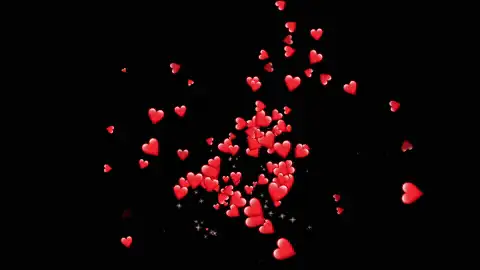

## Moon Phases

Emoji moons orbit slowly, each cycling through the moon phases from its own starting phase. Shows a sprite-sheet flipbook with random start frames.

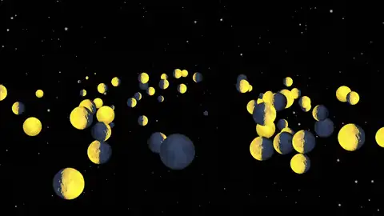

## Color Smoke

Thick, nearly opaque colored smoke billows up and out. Every puff overlaps others, so drawing back to front matters: set Sort to None to see far puffs paint over near ones.

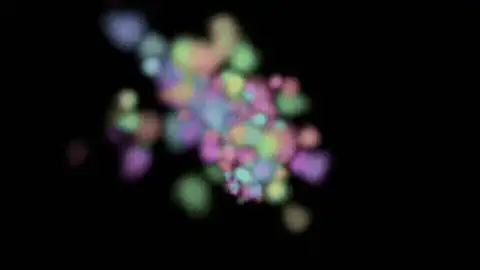

## Fog

Low fog drifts across the ground and around a box, a ball, and a log. The colliders are drawn as solids, and the fog is soft: each puff fades where it meets a surface instead of cutting a hard line through it. Set Softness to 0 to see the hard edges.

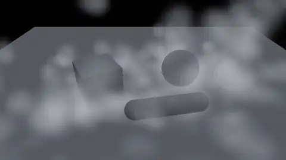

## Pond

Raindrops fall into a pond, and each one spreads a ripple that lies flat on the water. Shows fixed (flat) orientation and emoji droplet sprites.

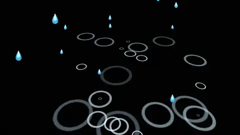

## Ring of Fire

A ring of emoji flames seen from above. The flames are Y-aligned: they stay upright and turn only around Y, instead of tipping toward the camera like billboards.

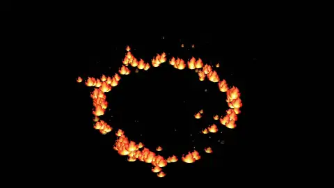

## Swarms

Two identical firefly swarms circle side by side. The gold one simulates in local space and travels as a tight cloud; the blue one simulates in world space and leaves a trail.

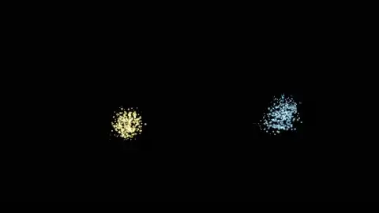

## Geyser

A geyser erupts for 1.5 seconds every 4: water shoots from a cylinder, rocks tumble out and bounce, and steam rises from a cone. Shows the emit/idle loop, opaque particles, and screen blending.

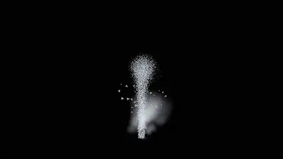

## Bumper

Balls drop onto a bumper. Each hit bursts sparks, balls that bounce into the goal burst stars, a ring pulses every 2 seconds, and sending the event 'boom' fires confetti. Shows the emission triggers.

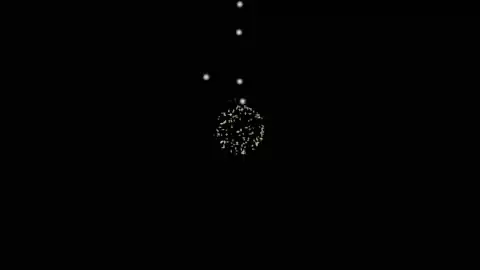

## Paddle Wheel

Sand pours onto a spinning paddle wheel, which flings it across the ground. The two blades are box colliders that turn at a steady rate (colliderSpins); their spin throws the sand that hits them, and fast blades do not tunnel through it.

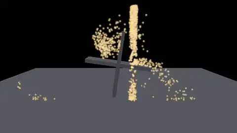

## Teapot

The Utah teapot outlined in glowing particles, slowly dissolving into sand that pours onto the ground. Shows emission from the surface of a mesh.

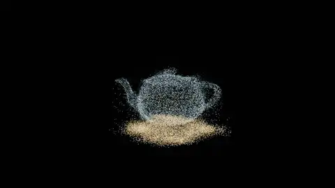

## Flag

A flag of glowing sparks waves from a pole. The flag is a mesh that the system deforms every frame, and the sparks are born on its moving surface. Shows a deforming mesh emitter (meshDeformation).

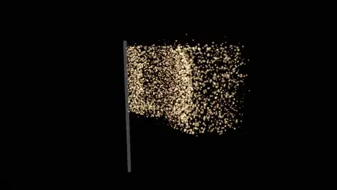

## Strange Attractor

Glowing particles trace the Lorenz attractor. A user Metal function (updateFunction) sets each particle's velocity from the Lorenz equations every step; nothing in the built-in settings moves them.

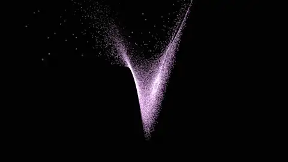

## Pointer Stir

Glowing dust hangs in the air. Move the mouse over the view: a vortex and a ball follow the pointer, stirring the dust and pushing it aside. Shows pointer bindings (pointerBindings); without a mouse, the pointer traces a figure eight (pointerMotion).

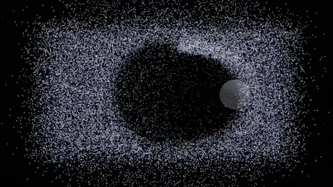

## Embers to Ash

Glowing embers rise from a fire. After 1.4 seconds each one turns into a gray flake of ash that drifts down, and when the ash lands it turns into a small puff of dust. Shows chained transitions: sub-emitters that replace their parent (SubEmitter.transition), at an age and then on a collision, each with its own sprite and settings.

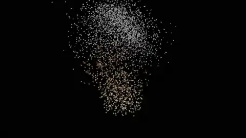

## Awning

Rain falls straight through an awning and slants in the wind, while sparks from a grinder land on the awning and slide off. Shows category masks: each emitter chooses which colliders and fields affect it.

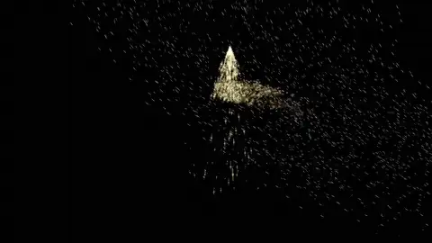

## Lantern

Smoke and dust lit by a warm lantern and cool moonlight. Shows particle lighting: point and directional lights over low ambient light.

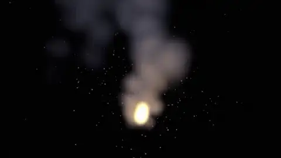

## Dunk

A ball bounces through a pool, and every time it enters the water a splash bursts up. Shows a tracked object and an object-enters trigger.

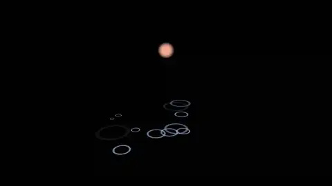

## Flare

A road flare that ignites, burns, and dies out: sparks and pink smoke whose emission ramps up over half a second, burns for three, and fades out by five seconds. Shows emission over time and a finite effect: once every particle has died the system reports it is finished (the HUD says Finished; Restart plays it again).

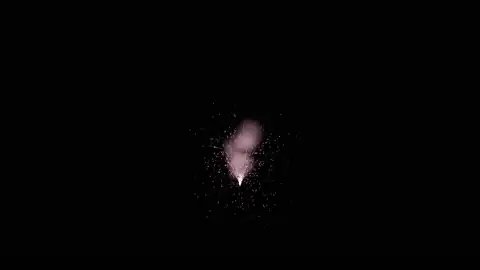

## Point Cloud

The word PARTICLES, baked as 1,500 colored points, shimmers and drifts toward the camera. Shows emitting from a point cache with per-point colors.

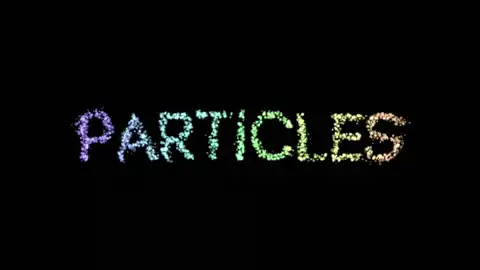

## Fireflies

Fireflies drift over a dark meadow, each blinking at its own rate. User Metal functions store a per-firefly phase and rate in ParticleState.custom at birth, then pulse ParticleState.size and color from it every step.

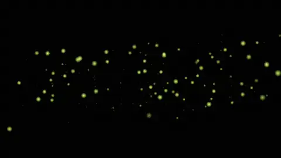

## Butterfly Dust

A butterfly emoji dissolves into colored dust that drifts away on the breeze. Shows emitting from an image: particles are born on its opaque pixels and take their colors.

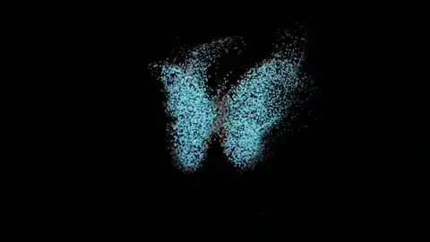

## Paint Drops

Paint drops fall and splatter where they land. Each landing is reported back to the app as an event with its position (reportsCollisions), and the app bursts the splatter layer there (eventBursts).

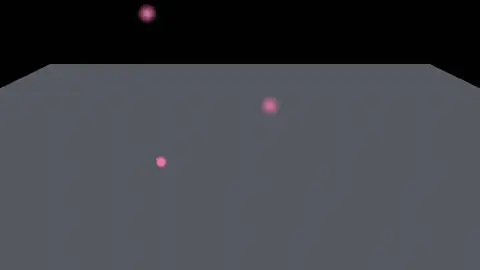

## Magic Loop

Sparkles stream around a wavy loop, guided by a path force field: a smooth curve through a few points that carries particles along it and pulls strays back on. A little turbulence makes the stream shimmer.

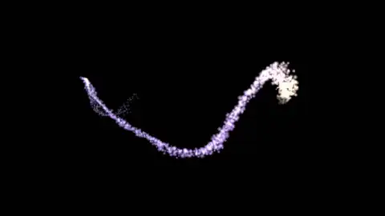

## Torch Avenue

Two rows of torches recede into the night. Each torch uses distance LOD: it emits fully up close and a fifth as much far away, where the difference does not show, and a culling radius skips it when it is out of view.

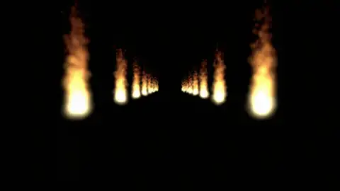

## Ember Glow

Smoke rises in the dark, lit only by the embers drifting through it. Twelve embers become point lights each frame (ParticleEmitter.light), and the lit smoke picks up their orange glow where they pass.

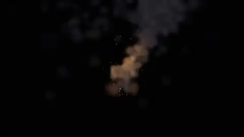

## Coin Shower

Gold coins rain down, tumble, and bounce on the floor. Each particle is drawn as a small 3D coin (ParticleEmitter.particleMesh), lit with real normals, so the faces flash as they turn.

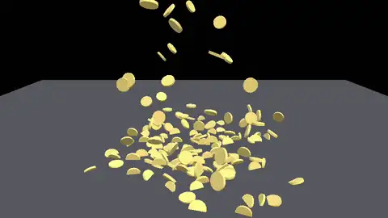

## Sand on Shapes

Sand pours onto a box, a sphere, a capsule, and the floor. The sand ignores the colliders: it bounces off the scene depth (collidesWithSceneDepth), the same way it would land on any geometry an app draws.

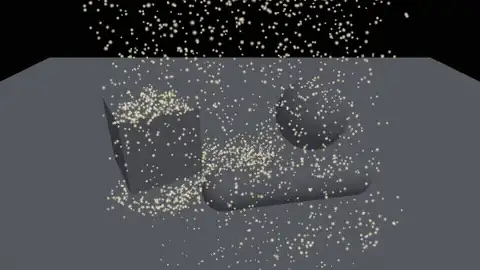

## Spark Spectrum

A fountain of sparks colored three ways at once: white-hot while fast and deep red as they slow (colorBySpeed), each spark leaning toward a gold or a magenta palette (alternateColorOverLife), and a cool blue wash toward the top of the arc (colorByPosition).

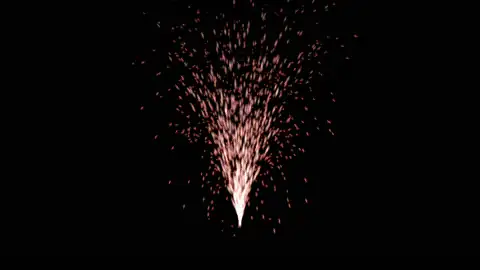

## Light Ribbons

Glowing particles swirl around a vortex, each drawing a long tapered ribbon through its last 48 positions (ParticleEmitter.trail), like light painting.

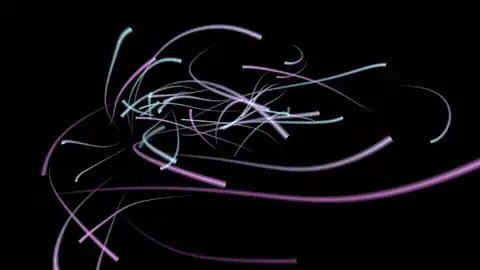

## Murmuration

Twelve thousand starlings wheel as one. Each bird steers by its neighbors only: away from the closest, along with the local average heading, and toward the local center (ParticleEmitter.flocking), using a spatial grid rebuilt on the GPU every frame. A gentle attractor keeps the flock in view.

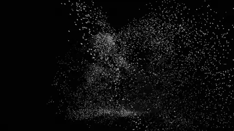
