# MetalSprocketsParticles Demos

Every sample preset as a four-second loop, rendered offscreen with `particles-render --video` (seed 0, the
preset's camera). Regenerate them with `Scripts/make-demos.sh`.

## Contents

- [Fountain](#fountain)
- [Campfire](#campfire)
- [Fireworks](#fireworks)
- [Sparks](#sparks)
- [Snow](#snow)
- [Rain](#rain)
- [Magic Trail](#magic-trail)
- [Comet](#comet)
- [Galaxy](#galaxy)
- [Waterfall](#waterfall)
- [Confetti](#confetti)
- [Portal](#portal)
- [Hearts](#hearts)
- [Moon Phases](#moon-phases)
- [Color Smoke](#color-smoke)
- [Fog](#fog)
- [Pond](#pond)
- [Ring of Fire](#ring-of-fire)
- [Swarms](#swarms)
- [Geyser](#geyser)
- [Bumper](#bumper)
- [Paddle Wheel](#paddle-wheel)
- [Teapot](#teapot)
- [Flag](#flag)
- [Strange Attractor](#strange-attractor)
- [Pointer Stir](#pointer-stir)
- [Embers to Ash](#embers-to-ash)
- [Awning](#awning)
- [Lantern](#lantern)
- [Dunk](#dunk)
- [Flare](#flare)
- [Point Cloud](#point-cloud)
- [Fireflies](#fireflies)
- [Butterfly Dust](#butterfly-dust)
- [Paint Drops](#paint-drops)
- [Magic Loop](#magic-loop)
- [Torch Avenue](#torch-avenue)
- [Ember Glow](#ember-glow)
- [Coin Shower](#coin-shower)
- [Sand on Shapes](#sand-on-shapes)
- [Spark Spectrum](#spark-spectrum)
- [Light Ribbons](#light-ribbons)
- [Murmuration](#murmuration)
- [Streamers](#streamers)
- [Living Picture](#living-picture)
- [Stress Test](#stress-test)
- [Pachinko](#pachinko)
- [Whirlpool](#whirlpool)
- [Sand Funnel](#sand-funnel)
- [Spinning Teapot](#spinning-teapot)
- [Umbrella](#umbrella)
- [Marble Run](#marble-run)
- [Snow Globe](#snow-globe)
- [Sand on Letters](#sand-on-letters)
- [Inside the Teapot](#inside-the-teapot)
- [Foil Confetti](#foil-confetti)

## Fountain

Shows: gravity, bounce, and moving colliders that push and carry particles. A fountain sprays onto the ground and a few moving colliders.

## Campfire

Shows: additive and alpha blending in one effect, back-to-front sorting, velocity-stretched sparks, turbulence, and rotated capsule colliders. Flames, smoke, and embers over two logs.

## Fireworks

Shows: sub-emitters, with a while-alive trail and an on-death burst. Rockets climb, leave sparkle trails, and burst into shells of stars.

## Sparks

Shows: velocity-aligned stretching, bounce with per-particle variation, and friction. Grinder sparks streak across the floor and bounce off a wall.

## Snow

Shows: plane emission over a large area, turbulence, and particles that come to rest on colliders. Snow drifts down onto the ground and a sphere.

## Rain

Shows: velocity stretching, die-on-collision, and an on-collision sub-emitter. Rain falls on the ground and a tilted slab and splashes where it lands.

## Magic Trail

Shows: a moving emitter, births spread along its path, and inherited velocity. A wand of stars traces a figure eight.

## Comet

Shows: a fast-moving emitter that still leaves a smooth trail. A comet circles overhead with a long tail and a bright core.

## Galaxy

Shows: torus emitters, a vortex force field, and an attractor. Two spiral arms of stars swirl around a bright core.

## Waterfall

Shows: a box emitter, collisions, and soft, sorted mist. Water pours over a ledge, hits rocks, and throws up mist.

## Confetti

Shows: a one-shot emitter (an emission duration that does not loop) that makes the effect finite, textured sprites with random spin, turbulence, and friction. When every piece is gone the HUD says Finished, and Restart plays it again. A party popper fires one burst of confetti.

## Portal

Shows: tangential birth direction and a spinning emitter whose births spread along its rotation. A ring of fire throws sparks off its rim like a Catherine wheel.

## Hearts

Shows: emoji sprites drawn with Core Text, tinted white so they keep their own colors. Hearts float up and wobble, with pink sparkles.

## Moon Phases

Shows: a sprite-sheet flipbook with random start frames. Emoji moons orbit and cycle through the moon phases.

## Color Smoke

Shows: back-to-front sorting of nearly opaque particles. Set Sort to None to see far puffs paint over near ones. Thick colored smoke billows up.

## Fog

Shows: soft particles that fade where they meet a surface, and colliders drawn as solids. Set Softness to 0 to see the hard edges. Low fog drifts around a box, a ball, and a log.

## Pond

Shows: fixed (flat) orientation and emoji sprites. Raindrops fall into a pond and spread ripples that lie flat on the water.

## Ring of Fire

Shows: Y-aligned orientation, which keeps particles upright and turns them only around Y. A ring of emoji flames seen from above.

## Swarms

Shows: local and world simulation space side by side. The gold swarm (local) travels as a tight cloud; the blue one (world) leaves a trail.

## Geyser

Shows: an emit/idle loop, opaque particles, screen blending, and cylinder and cone emitters. A geyser erupts water, rocks, and steam for 1.5 seconds every 4.

## Bumper

Shows: emission triggers (collider hit, particles entering a volume, a timer, and a named event 'boom'). Balls drop onto a bumper and set off sparks, stars, rings, and confetti.

## Paddle Wheel

Shows: spinning colliders (colliderSpins) that throw particles and do not tunnel at high speed. Sand pours onto a spinning paddle wheel.

## Teapot

Shows: emission from the surface of a mesh. The Utah teapot outlined in glowing particles dissolves into sand.

## Flag

Shows: a deforming mesh emitter (meshDeformation), with births on its moving surface. A flag of sparks waves from a pole.

## Strange Attractor

Shows: a user Metal function (updateFunction) that sets each particle's velocity every step. Particles trace the Lorenz attractor.

## Pointer Stir

Shows: pointer bindings (pointerBindings) that move a force field and a collider, and pointerMotion as a fallback without a mouse. Move the mouse to stir glowing dust.

## Embers to Ash

Shows: chained transitions (SubEmitter.transition), at an age and on a collision, each with its own sprite and settings. Embers turn into ash, and ash turns into dust when it lands.

## Awning

Shows: category masks, where each emitter chooses which colliders and fields affect it. Rain falls through an awning in the wind; grinder sparks land on it.

## Lantern

Shows: particle lighting with point and directional lights over low ambient light. Smoke and dust lit by a lantern and moonlight.

## Dunk

Shows: a tracked object and an object-enters trigger. A ball bounces through a pool and splashes each time it enters the water.

## Flare

Shows: emission over time (ramp up, sustain, fade out) and a finite effect that reports when it is finished. The HUD says Finished; Restart plays it again. A road flare ignites, burns, and dies out.

## Point Cloud

Shows: emission from a point cache with per-point colors. The word PARTICLES, baked as 1,500 points, drifts toward the camera.

## Fireflies

Shows: user Metal functions that store per-particle data in ParticleState.custom at birth and drive size and color from it every step. Fireflies blink at their own rates.

## Butterfly Dust

Shows: emission from an image, with births on its opaque pixels and colors taken from them. A butterfly emoji dissolves into dust.

## Paint Drops

Shows: collision events reported back to the app (reportsCollisions) and app-driven bursts at a position (eventBursts). Paint drops splatter where they land.

## Magic Loop

Shows: a path force field that carries particles along a smooth curve and pulls strays back, plus turbulence. Sparkles stream around a wavy loop.

## Torch Avenue

Shows: distance LOD (full emission up close, a fifth far away) and culling of emitters outside the view. Two rows of torches recede into the night.

## Ember Glow

Shows: particles as lights (ParticleEmitter.light): twelve embers become point lights each frame and light the smoke. Smoke rises in the dark.

## Coin Shower

Shows: mesh particles (ParticleEmitter.particleMesh) lit with real normals, random spin, and bounce. Gold coins rain down and tumble.

## Sand on Shapes

Shows: collision with the scene depth buffer (collidesWithSceneDepth) instead of colliders, so particles land on any geometry the app draws. Sand pours onto shapes.

## Spark Spectrum

Shows: three color modes at once: color by speed (colorBySpeed), a second palette per particle (alternateColorOverLife), and color by position (colorByPosition). A fountain of sparks.

## Light Ribbons

Shows: per-particle tapered trails (ParticleEmitter.trail) through the last 48 positions, and a vortex. Glowing particles swirl like light painting.

## Murmuration

Shows: GPU flocking (ParticleEmitter.flocking) with separation, alignment, and cohesion over a spatial grid rebuilt every frame, plus an attractor. Twelve thousand starlings.

## Streamers

Shows: emitter ribbons (ParticleEmitter.ribbon) that join particles in birth order, shaped by size and color over life. Two emitters fly a figure eight and a circle.

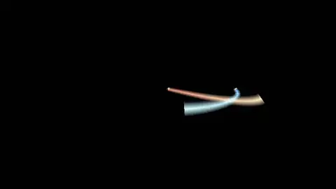

## Living Picture

Shows: color from a screen-space image (ParticleEmitter.colorImage), so each particle takes the picture's color wherever it is. A sunset painted with drifting particles.

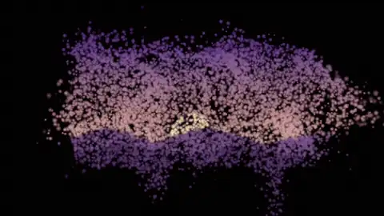

## Stress Test

Shows: scale and throughput: two million live particles, a million born every second, moved by curl noise. Use it for profiling and with particles-bench --presets.

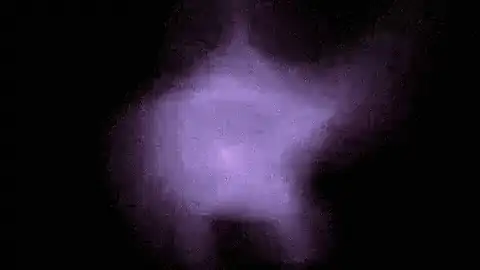

## Pachinko

Shows: 2D mode with colliders seen edge-on. Balls drop from the top and bounce down through rows of pegs between two walls.

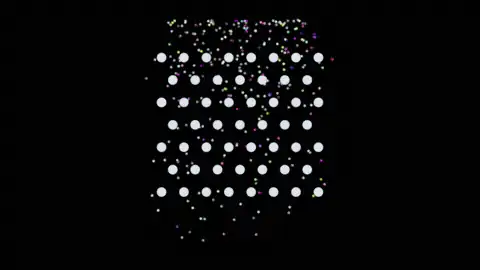

## Whirlpool

Shows: 2D mode with force fields in the plane. A vortex and an attractor wind two streams of particles into spiral arms that drain at the center.

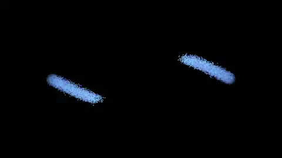

## Sand Funnel

Shows: 2D mode with rotated box colliders. Sand pours into a funnel, slides down its sides, and trickles through the gap in a thin stream.

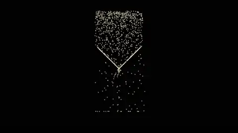

## Spinning Teapot

Shows: a collider baked from a mesh (a SwiftMesh teapot as a signed distance field) that turns each frame, as a scene-graph node would. Sand rains on the spinning teapot and is flung off its spout and handle.

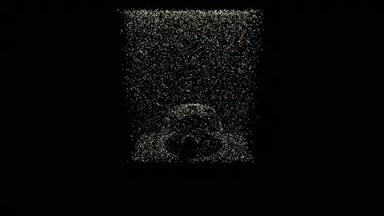

## Umbrella

Shows: a collider baked from an open mesh, as a thin shell (an uncapped SwiftMesh hemisphere). Rain bounces off the umbrella and runs off its rim.

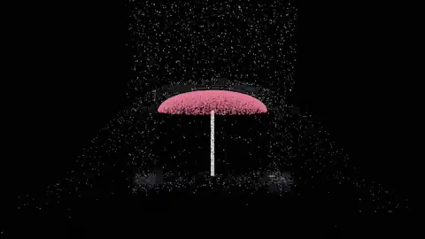

## Marble Run

Shows: particles riding a curved mesh collider. Marbles roll down a helical track (a swept SwiftMesh mesh baked to a distance field) and drop off the end.

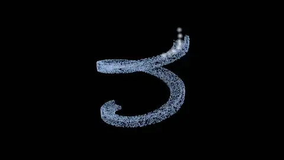

## Snow Globe

Shows: an interactive 2D effect inside a distance field container. Snow swirls in a globe; the vortex follows the mouse.

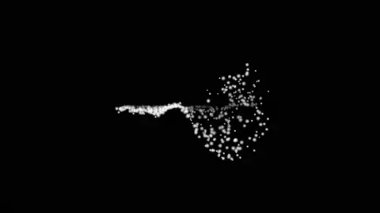

## Sand on Letters

Shows: collision with an arbitrary concave mesh. Sand pours over 3D text (a SwiftMesh text extrusion baked to a distance field), drifts round the letters, and fills the hole in the D.

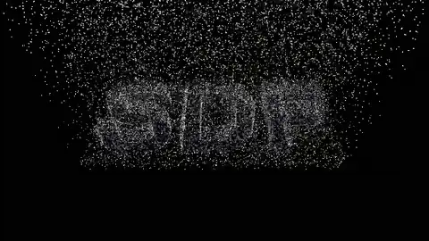

## Inside the Teapot

Shows: a mesh turned inside out as a container (its baked distance field negated). Beads tumble inside a teapot as it rolls over.

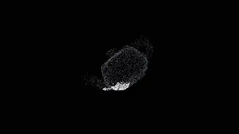

## Foil Confetti

Shows: foil shading on tumbling sprites. Confetti cards flutter down, flashing as they turn to catch the lights, with a sparkle at each flash, and shifting color with the angle.

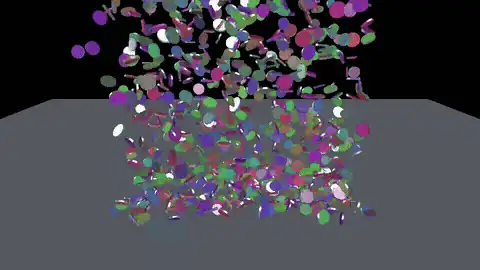
