# MetalSprocketsParticles Demos

Six-second clips of every built-in preset, rendered offscreen with `particles-render --video` (1280×720, re-encoded to H.264 MP4, 30 fps, seed 0, the preset's camera).

## Contents

- [Fountain](#fountain)
- [Campfire](#campfire)
- [Fireworks](#fireworks)
- [Sparks](#sparks)
- [Snow](#snow)
- [Rain](#rain)
- [Magic Trail](#magic-trail)
- [Comet](#comet)
- [Galaxy](#galaxy)
- [Waterfall](#waterfall)
- [Confetti](#confetti)
- [Portal](#portal)
- [Hearts](#hearts)
- [Moon Phases](#moon-phases)
- [Color Smoke](#color-smoke)
- [Fog](#fog)
- [Pond](#pond)
- [Ring of Fire](#ring-of-fire)
- [Swarms](#swarms)
- [Geyser](#geyser)
- [Bumper](#bumper)
- [Paddle Wheel](#paddle-wheel)
- [Teapot](#teapot)
- [Flag](#flag)
- [Awning](#awning)
- [Lantern](#lantern)
- [Dunk](#dunk)

## Fountain

A water fountain sprays up and falls back onto the ground and a few colliders that move around. Shows gravity, bouncing, and colliders that push and carry particles as they move.

[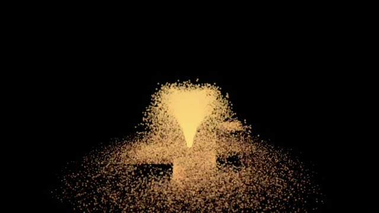](videos/fountain.mp4)

## Campfire

Flames, rising smoke, and embers over two logs. The flames are additive smoke puffs, the smoke is alpha-blended and sorted back to front, the embers are velocity-stretched sparks, and turbulence makes everything flicker. The logs are rotated capsule colliders.

[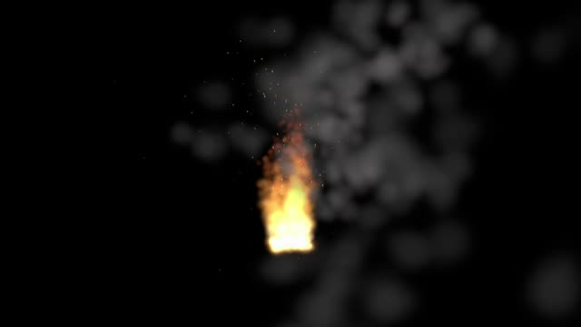](videos/campfire.mp4)

## Fireworks

Rockets climb from the ground, leave sparkle trails, and burst into shells of stars when they burn out. Shows sub-emitters: a while-alive trail and an on-death burst.

[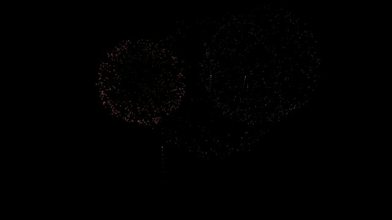](videos/fireworks.mp4)

## Sparks

Grinder sparks streak across the floor and bounce off a wall. Shows velocity-aligned stretching, bounce with per-particle variation, and friction.

[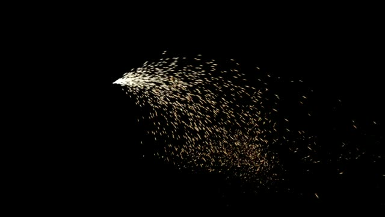](videos/sparks.mp4)

## Snow

Snowflakes drift down through gentle turbulence and settle on the ground and on a sphere. Shows plane emission over a large area, turbulence, and particles that come to rest on colliders.

[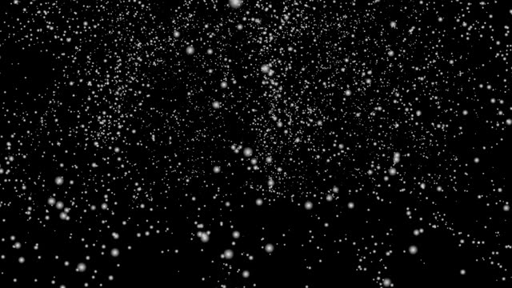](videos/snow.mp4)

## Rain

Rain falls onto the ground and a tilted slab. Each drop dies when it hits and splashes where it lands. Shows velocity stretching, die-on-collision, and an on-collision sub-emitter.

[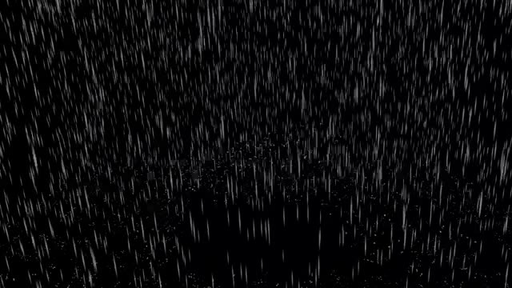](videos/rain.mp4)

## Magic Trail

A wand of stars traces a figure eight, leaving a continuous trail and drifting dust. Shows a moving emitter, births spread along its path, and inherited velocity.

[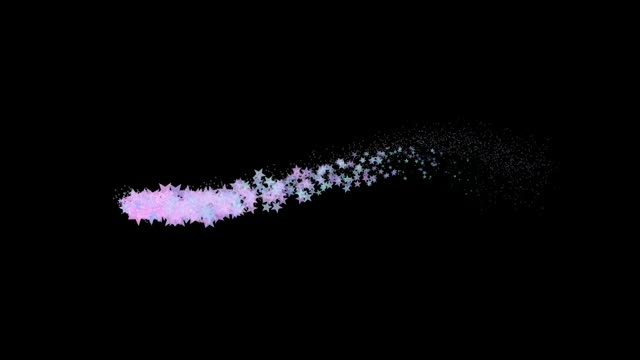](videos/magic-trail.mp4)

## Comet

A comet circles overhead with a long glowing tail and a bright core. Shows a fast-moving emitter that still leaves a smooth trail.

[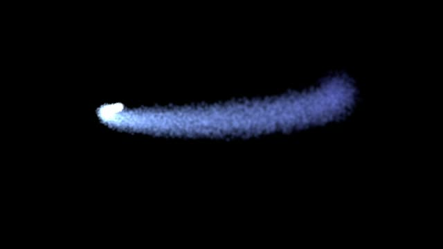](videos/comet.mp4)

## Galaxy

Two spiral arms of stars swirl around a bright core. Shows torus emitters, a vortex force field, and an attractor.

[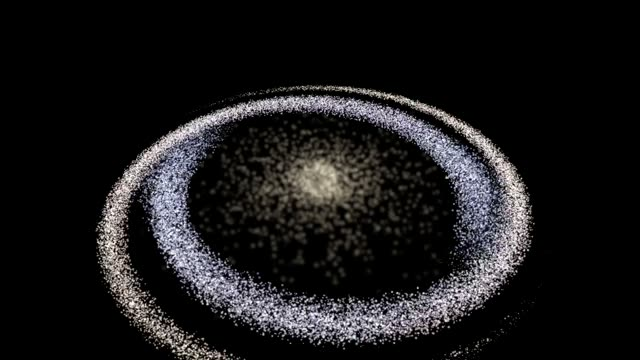](videos/galaxy.mp4)

## Waterfall

A sheet of water pours over a ledge, hits rocks, and throws up mist. Shows a box emitter, collisions, and soft sorted mist.

[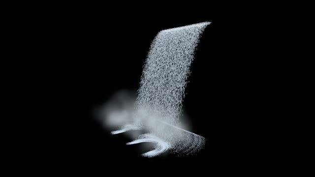](videos/waterfall.mp4)

## Confetti

A party popper fires one burst of confetti, which flutters down, settles on the ground, and fades. Shows a one-shot emitter (an emission duration that does not loop), textured sprites with random spin, turbulence, and friction. The clip ends when the effect finishes.

[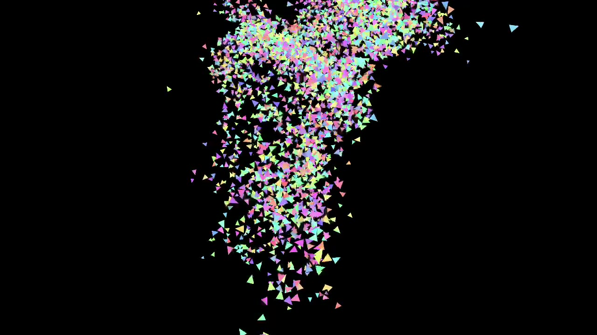](videos/confetti.mp4)

## Portal

A sorcerer's portal: a spinning ring of fire that throws sparks off its rim like a Catherine wheel. Shows tangential birth direction and a spinning emitter whose births spread along its rotation.

[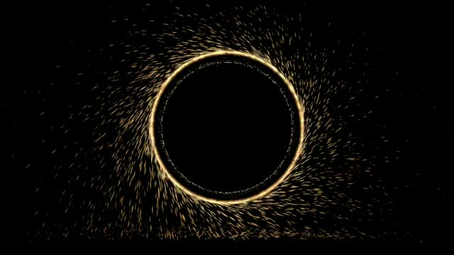](videos/portal.mp4)

## Hearts

Emoji hearts float up and wobble, with pink sparkles. Shows emoji sprites drawn with Core Text: tint them white so they keep their own colors.

[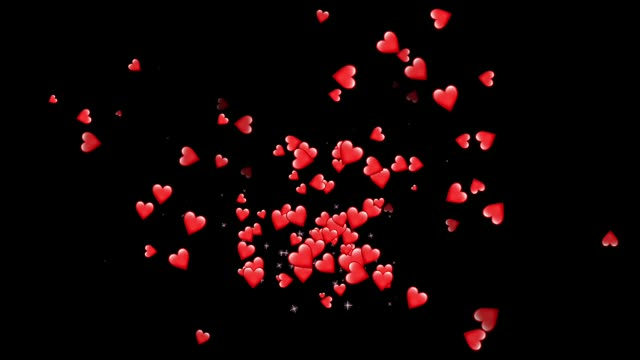](videos/hearts.mp4)

## Moon Phases

Emoji moons orbit slowly, each cycling through the moon phases from its own starting phase. Shows a sprite-sheet flipbook with random start frames.

[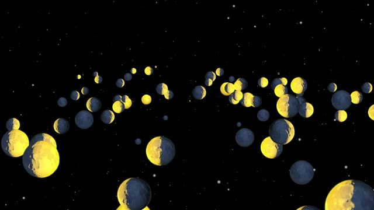](videos/moon-phases.mp4)

## Color Smoke

Thick, nearly opaque colored smoke billows up and out. Every puff overlaps others, so drawing back to front matters: set Sort to None to see far puffs paint over near ones.

[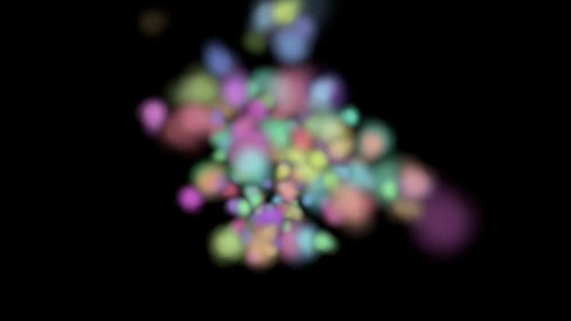](videos/color-smoke.mp4)

## Fog

Low fog drifts across the ground and around a box, a ball, and a log. The colliders are drawn as solids, and the fog is soft: each puff fades where it meets a surface instead of cutting a hard line through it.

[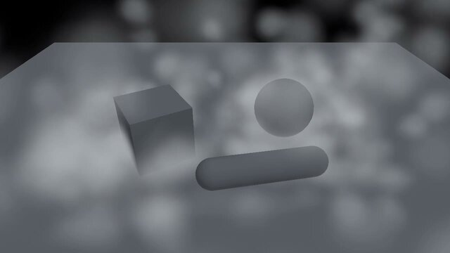](videos/fog.mp4)

## Pond

Raindrops fall into a pond, and each one spreads a ripple that lies flat on the water. Shows fixed (flat) orientation and emoji droplet sprites.

[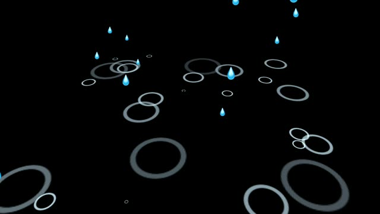](videos/pond.mp4)

## Ring of Fire

A ring of emoji flames seen from above. The flames are Y-aligned: they stay upright and turn only around Y, instead of tipping toward the camera like billboards.

[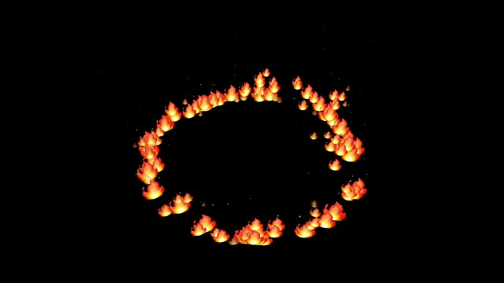](videos/ring-of-fire.mp4)

## Swarms

Two identical firefly swarms circle side by side. The gold one simulates in local space and travels as a tight cloud; the blue one simulates in world space and leaves a trail.

[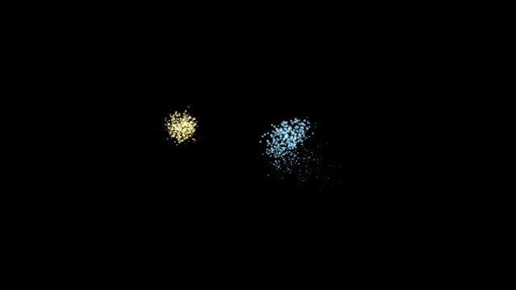](videos/swarms.mp4)

## Geyser

A geyser erupts for 1.5 seconds every 4: water shoots from a cylinder, rocks tumble out and bounce, and steam rises from a cone. Shows the emit/idle loop, opaque particles, and screen blending.

[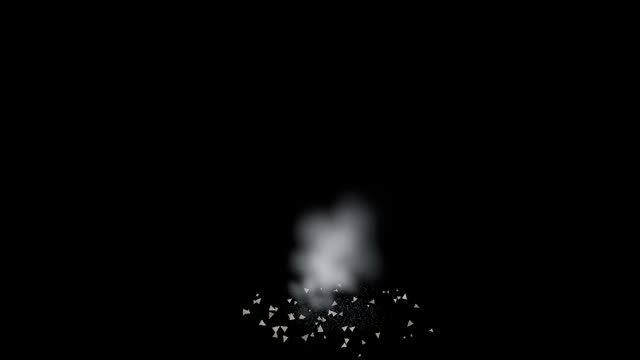](videos/geyser.mp4)

## Bumper

Balls drop onto a bumper. Each hit bursts sparks, balls that bounce into the goal burst stars, a ring pulses every 2 seconds, and sending the event 'boom' fires confetti. Shows the emission triggers.

[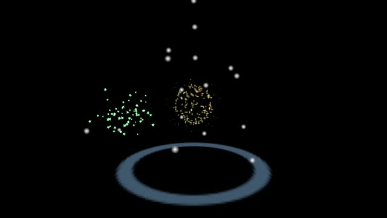](videos/bumper.mp4)

## Paddle Wheel

Sand pours onto a spinning paddle wheel, which flings it across the ground. The two blades are box colliders that turn at a steady rate; their spin throws the sand that hits them.

[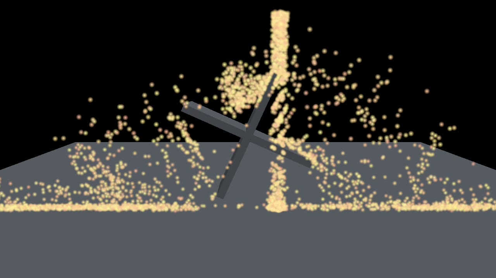](videos/paddle-wheel.mp4)

## Teapot

The Utah teapot outlined in glowing particles, slowly dissolving into sand that pours onto the ground. Shows emission from the surface of a mesh.

[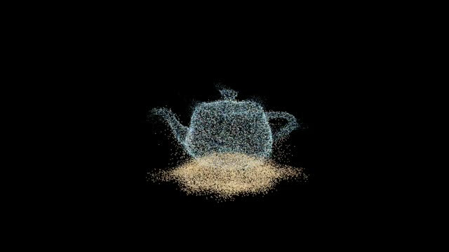](videos/teapot.mp4)

## Flag

A flag of glowing sparks waves from a pole. The flag is a mesh that the system deforms every frame, and the sparks are born on its moving surface. Shows a deforming mesh emitter.

[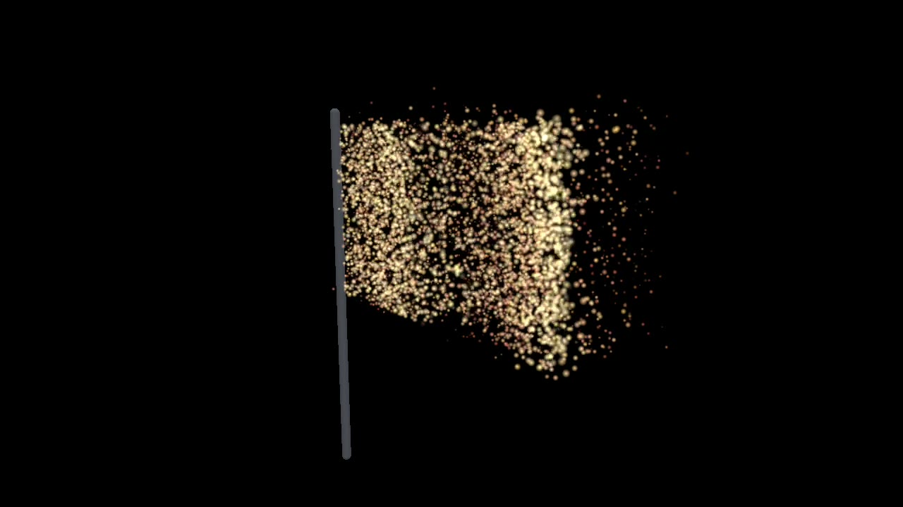](videos/flag.mp4)

## Awning

Rain falls straight through an awning and slants in the wind, while sparks from a grinder land on the awning and slide off. Shows category masks: each emitter chooses which colliders and fields affect it.

[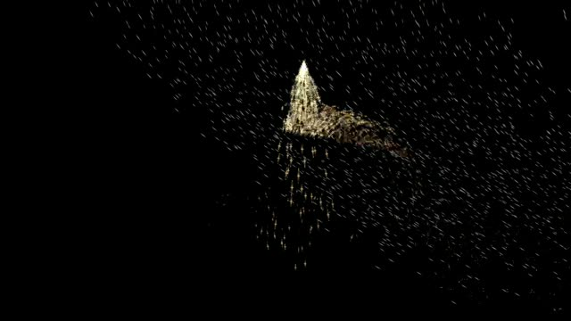](videos/awning.mp4)

## Lantern

Smoke and dust lit by a warm lantern and cool moonlight. Shows particle lighting: point and directional lights over low ambient light.

[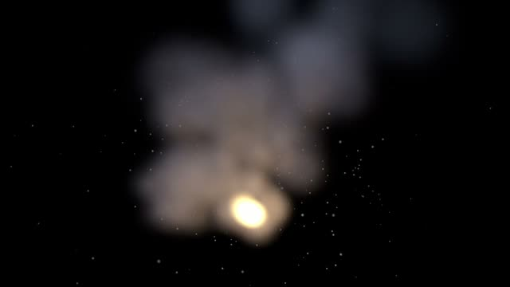](videos/lantern.mp4)

## Dunk

A ball bounces through a pool, and every time it enters the water a splash bursts up. Shows a tracked object and an object-enters trigger.

[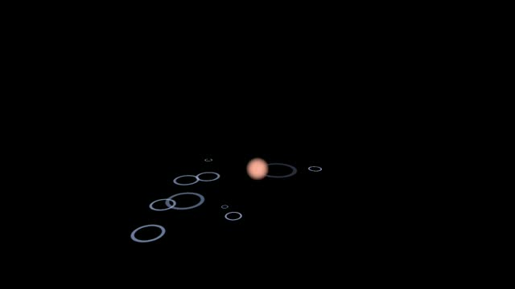](videos/dunk.mp4)
